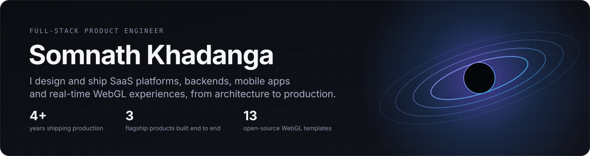

<div align="center">



<br/>

<a href="https://www.somanathkhadanga.com/"></a>
<a href="https://demo.somanathkhadanga.com"></a>
<a href="https://www.linkedin.com/in/somnath-khadanga/"></a>

</div>

<br/>

## Selected work

| | Project | What it is |
|---|---|---|
| ☕ | [**PaperChai**](https://github.com/somnathraz/paperchai) | AI-powered invoicing and cash-flow automation. Gemini, reminders, forecasting, Slack and Notion. |
| 🔐 | [**AuthSass**](https://github.com/somnathraz/AuthSass) | Multi-tenant authentication infrastructure for SaaS products. |
| 📱 | [**BillGen**](https://github.com/somnathraz/BillGen) | Mobile-first billing platform. React Native, Django REST, PostgreSQL. |
| 🎛️ | [**nextjs-webgl-templates**](https://github.com/somnathraz/nextjs-webgl-templates) | 13 open-source R3F / GLSL templates: raymarching, GPU fluids, particles. |
| 🪤 | [**interview-traps**](https://github.com/somnathraz/interview-traps) | Backend interview traps you can run, with a test that proves each fix. |

## How I work

I own the whole path: **idea → architecture → frontend → backend → integrations → cloud → production.** My focus is systems that stay reliable under real use: auth, payments, scheduling, async workflows, and AI features that are wired into the product instead of bolted on.

## Stack

| | |
|---|---|
| **Frontend** | React, Next.js, TypeScript, Redux, Zustand, Tailwind |
| **3D / Graphics** | Three.js, React Three Fiber, GLSL, GPGPU |
| **Mobile** | React Native |
| **Backend** | Node.js, Express, Django, Java, Spring Boot |
| **Data** | PostgreSQL, MongoDB, Prisma |
| **Cloud** | AWS, Docker, GitHub Actions |
| **Integrations** | Stripe, Google Calendar, Firebase, Supabase, REST, GraphQL |
| **AI** | Gemini, LLM integrations, agentic workflows |

---

## Flagship projects

<table>
<tr>

<td width="50%" valign="top">

## ☕ PaperChai

### AI-powered invoicing & cash-flow automation

A SaaS platform designed to simplify invoicing for freelancers and agencies while automating repetitive payment workflows.

Instead of behaving like traditional accounting software, PaperChai focuses on **speed, automation and payment intelligence**.

### Engineering highlights

- AI-assisted invoice generation using Gemini
- Automated payment reminders
- Scheduled invoice workflows
- Cash-flow forecasting
- Client payment-reliability insights
- Slack integration
- Notion integration
- Multi-workspace architecture
- Custom email workflows
- PDF invoice generation
- AI-assisted follow-up automation

### Architecture

`Next.js` • `React` • `PostgreSQL`  
`Prisma` • `Gemini` • `NextAuth`  
`Puppeteer` • `Tailwind CSS`

<br/>

<a href="https://github.com/somnathraz/paperchai">

</a>

</td>

<td width="50%" valign="top">

## 🔐 AuthSass

### Multi-tenant authentication infrastructure

A reusable authentication and authorization platform designed for SaaS applications that need organizations, users, applications and isolated tenant access.

The goal is to move authentication infrastructure outside individual products so multiple applications can share a consistent identity platform.

### Engineering highlights

- Multi-tenant architecture
- Users & organizations
- Organization memberships
- Application memberships
- Invitation workflows
- Refresh-token lifecycle
- API keys
- Audit logging
- Role-based authorization
- Tenant-aware access control

### Architecture

`Node.js` • `Express` • `Apollo`  
`GraphQL` • `MongoDB` • `JWT`

<br/>

<a href="https://github.com/somnathraz/AuthSass">

</a>

</td>

</tr>
</table>

<br/>

<table>
<tr>

<td width="50%" valign="top">

## 📱 BillGen

### Mobile-first business billing platform

A cross-platform billing application built with a separate mobile frontend and backend API architecture.

The project separates presentation, business logic and persistence instead of treating the mobile application as a standalone client.

### Architecture

```text
React Native Application
          │
          │ REST API
          ▼
Django REST Framework
          │
          ▼
      PostgreSQL
